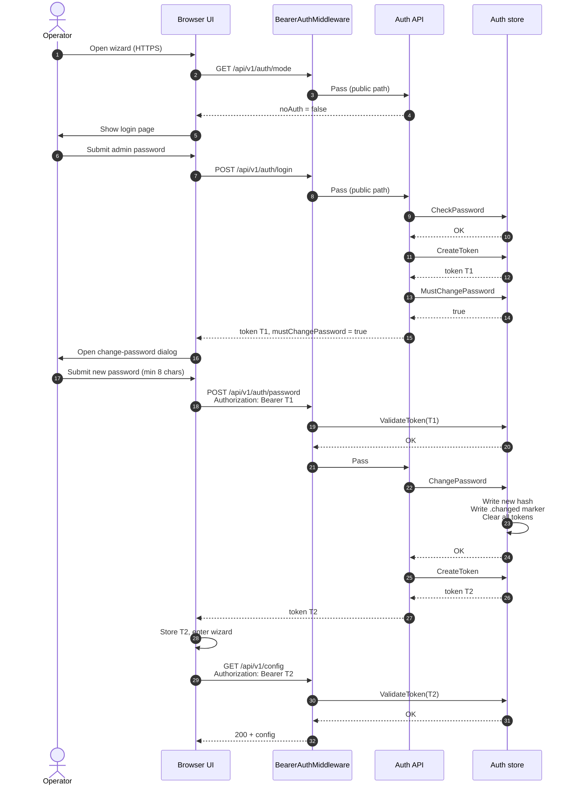

# Authentication

This document explains how Enclave Wizard authenticates users and protects its API.

This document's audience is operators who run the wizard, and contributors who need to understand how the auth code works.

## Summary

Enclave Wizard uses a single local admin account. There is no multi-user
directory and no external Identity Provider (IdP).

1. The operator signs in with username `admin` and a password.
2. The server returns an opaque bearer token.
3. The browser sends that token on later API calls.
4. The server rejects API calls that have no valid token.

Transport Layer Security (TLS) protects the connection. HTTP requests redirect
to HTTPS.

## Who can sign in

The only username is `admin`. The login form shows that name and does not let
you change it.

The server stores one password hash. That hash is the only credential for the
admin account.

## First start

When the wizard process starts, it initializes the auth store from a password
file (default path: `/etc/enclave-wizard/password`).

| Condition | Result |
|-----------|--------|
| The password file exists and is not empty | The server loads the bcrypt hash from the file. |
| The password file is missing or empty | The server creates a random 16-character password, stores its bcrypt hash, and prints the plaintext password once. |

On first generation, the server also writes the plaintext password to
`/tmp/enclave-wizard-init-pass`. That file is created with mode `0644`, so
other local users on the host can read it until you remove it or change the
admin password. Treat it as a temporary secret. Deployment scripts and
end-to-end (E2E) tests that read it should run as the wizard process user or
as root when the file mode is tightened later.

The UI requires you to change the initial password on first successful login.
Until you change it, the UI keeps you on the login flow and opens the
change-password dialog. The API does not enforce this requirement. A token
returned by `/api/v1/auth/login` with `mustChangePassword=true` authorizes
protected `/api/v1/` paths until the password changes.

## Sign-in flow (operator view)

1. Open the wizard over HTTPS (default port `3443`).
2. Enter the admin password on the login page.
3. If the server still requires a password change, set a new password (minimum
   8 characters).
4. After a successful change, the UI enters the wizard.

Logout clears the token in the browser. The server does not keep a separate
logout endpoint. After logout, you must sign in again.

### First login and password change

This sequence shows the first sign-in, when the server still requires a password
change. Later API calls use the new token.



If login succeeds and `mustChangePassword` is `false`, the UI skips the
change-password dialog and uses token `T1` for later API calls.

## How API protection works

Most paths under `/api/v1/` require a bearer token. The middleware
`BearerAuthMiddleware` in `internal/api/auth.go` enforces this rule.

### Public API paths

These paths do not require a token:

| Method | Path | Purpose |
|--------|------|---------|
| `GET` | `/api/v1/auth/mode` | Reports whether auth is disabled (`noAuth`). |
| `POST` | `/api/v1/auth/login` | Checks the password and returns a token. |
| `GET` | `/api/v1/version` | Returns version information. |

### Protected API paths

Every other `/api/v1/*` path needs this header:

```http
Authorization: Bearer <token>
```

If the header is missing, invalid, or expired, the server returns HTTP `401`.

Static UI files are not under `/api/v1/`. They do not use bearer auth. The UI
still uses `AuthGuard` so unauthenticated users cannot open wizard routes in
the browser.

### Login request

```http
POST /api/v1/auth/login
Content-Type: application/json

{"username":"admin","password":"<password>"}
```

Success response fields:

| Field | Meaning |
|-------|---------|
| `token` | Opaque bearer token for later API calls. |
| `mustChangePassword` | `true` until the initial password has been changed. |

### Change password request

```http
POST /api/v1/auth/password
Authorization: Bearer <token>
Content-Type: application/json

{"currentPassword":"<old>","newPassword":"<new>"}
```

Rules:

- The current password must be correct.
- The new password must be at least 8 characters.
- The server invalidates all existing tokens.
- The response includes a new token. Use that token after the change.

## Tokens

Tokens are opaque random values (hex-encoded). They are not JSON Web Tokens
(JWTs).

| Property | Behavior |
|----------|----------|
| Lifetime | 24 hours from creation. |
| Storage on server | In memory only. A process restart drops all tokens. |
| Storage in browser | In React state only. A page reload clears the session. |
| Invalidation | Password change clears the token map. Expired tokens are pruned when a new token is created. |

When an API client receives HTTP `401`, the UI logs the operator out and
returns to the login page.

## Password storage on disk

| Path | Content |
|------|---------|
| `/etc/enclave-wizard/password` (default) | bcrypt hash of the admin password. The store creates this file with mode `0600`. |
| `/etc/enclave-wizard/password.changed` | Marker file. Its presence means the initial password was changed. |

Mode `0600` applies when the store creates or rewrites the password file. If you
pre-create the file yourself, set `chmod 0600` on it before startup. The store
does not change permissions on a non-empty file it only loads.

You can point the process at another password file with `--password-file`.

To create a hash offline and place it in the password file:

```bash
enclave-wizard hash-password '<plaintext-password>'
```

Write the printed hash into the password file before start. Do not store
plaintext passwords in that file. Set mode `0600` on that file.

## Development without auth

For local development only, start the server with `--no-auth`.

Effects:

- The middleware does not require bearer tokens.
- `GET /api/v1/auth/mode` returns `{"noAuth": true}`.
- The UI marks the session as authenticated and skips the login gate.

`make dev`, demo, and preview scripts use `--no-auth`. Do not use `--no-auth`
on a shared or production host.

## UI components (for contributors)

| Piece | Location | Role |
|-------|----------|------|
| Auth state and API calls | `ui/apps/wizard/src/auth/AuthContext.tsx` | Login, logout, password change, `noAuth` detection. |
| Login page | `ui/apps/wizard/src/auth/LoginPage.tsx` | Password form and forced change dialog. |
| Route guard | `ui/apps/wizard/src/main/AuthGuard.tsx` | Redirects to `/login` when not authenticated or when a password change is still required. |
| API client wiring | `ui/apps/wizard/src/main/Root.tsx` | Attaches `Authorization: Bearer …` and logs out on `401`. |

## Server components (for contributors)

| Piece | Location | Role |
|-------|----------|------|
| Password and token store | `internal/auth/auth.go` | Hash load/create, verify, change, token create/validate. |
| Auth HTTP handlers and middleware | `internal/api/auth.go` | Login, password change, auth mode, bearer middleware. |
| Process wiring | `main.go` | Creates the store, prints the initial password, wraps the mux with middleware. |

New `/api/v1/*` endpoints are protected by the same middleware unless you add
them to the public-path list. See
[how to add an API endpoint](contributing/how-to/add-api-endpoint.md)
(contributor guide).

## Automated checks

`hack/e2e/test_auth.sh` exercises the full auth path on a deployed instance:

1. Unauthenticated config request returns `401`.
2. Login with the initial password returns a token and `mustChangePassword: true`.
3. Authenticated request succeeds.
4. Password change returns a new token and rejects the old token.
5. Login with the old password fails; login with the new password succeeds.

## Limits of this design

- One admin account only.
- No role-based access control.
- Tokens do not survive a server restart or a browser reload.
- Auth is local to the wizard process. It does not integrate with cluster
Single Sign-On (SSO).

These limits match a bootstrap tool that runs on a Landing Zone host and
configures an enclave deployment.
